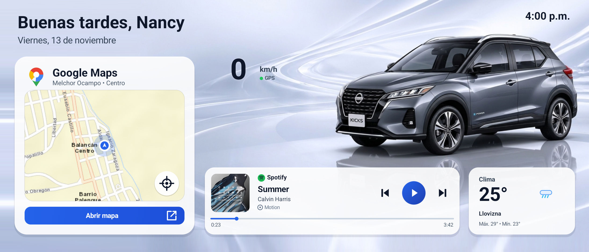

# KicksDashboard (ConsenAuto)

Dashboard personalizado para **Android Auto** y pantalla móvil optimizado para **Nissan Kicks e-POWER**.



## Características Principales

- **Mapa GPS en Tiempo Real (`MapTileManager` + `LocationPlaceResolver`)**:
  - Visualización en vivo con mosaicos cartográficos reales (ArcGIS World Street Map de día y ArcGIS Dark Gray de noche).
  - Indicador de rumbo y trazo azul del recorrido reciente.
  - Geocodificación inversa automática que muestra en tiempo real la calle y zona actual por donde circulas.
  - Botón directo para centrar ubicación y acceso rápido a Google Maps.
- **Reproductor Spotify (`SpotifyMediaListener`)**:
  - Sincronización en vivo con carátula del álbum, título de canción, artista y álbum.
  - Barra de progreso dinámica en tiempo real con tiempos y controles de reproducción (anterior, reproducir/pausar, siguiente).
- **Clima en Tiempo Real (`WeatherService`)**:
  - Datos en vivo de Open-Meteo basados en tu ubicación GPS: temperatura actual, descripción en español, ícono vectorial y temperaturas máxima / mínima del día.
- **Velocímetro Transparente (`GpsSpeedTracker`)**:
  - Velocidad en `km/h` e indicador de estado GPS integrados limpiamente junto al vehículo.
- **Saludo Dinámico y Modo Día / Noche Automático (`DashboardState`)**:
  - Mañana (`< 12:00`): *"Buenos días, Nancy"*
  - Tarde (`12:00 - 18:59`): *"Buenas tardes, Nancy"*
  - Noche (`>= 19:00`): *"Buenas noches, Nancy"* + cambio automático completo a **Modo Oscuro** (fondo nocturno de la Nissan Kicks, tarjetas en cristal oscuro y mapa nocturno).

## Instalación Rápida

- **APK compilado listo para instalar**: `ConsenAuto.apk` (también disponible en `release/ConsenAuto.apk`).
- **Por ADB (con origen Play Store para compatibilidad con Android Auto)**: ejecuta `instalar_consen_auto.bat` o:
  ```bash
  adb install -r -i "com.android.vending" ConsenAuto.apk
  ```
- **Por KingInstaller**: copia `ConsenAuto.apk` al teléfono e instálalo desde KingInstaller.
